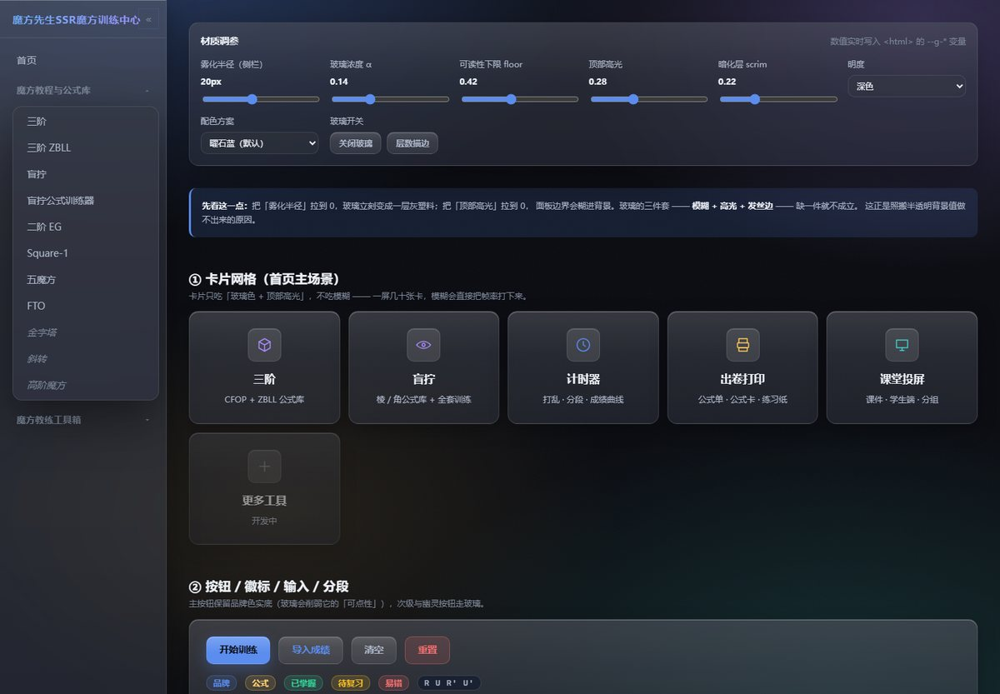
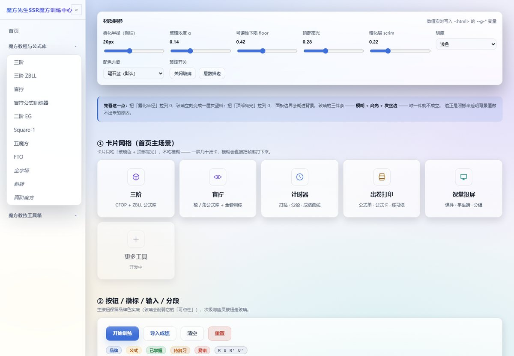
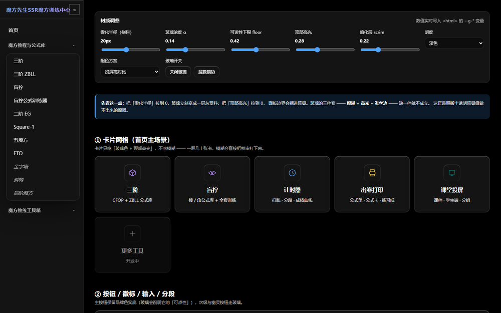
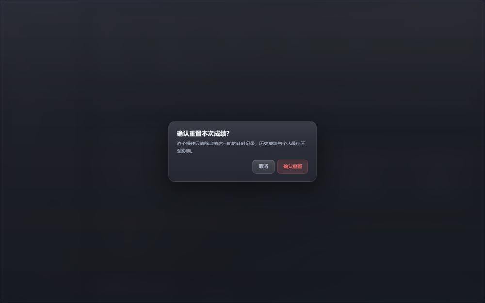

# 玻璃拟态主题设计方案

> 目标：把 DSH 这套「深色 + 玻璃 + 透明雾化」的观感搬到魔方站点，同时**不破坏**站点现有的令牌体系、6 套配色和 119 个页面。
>
> 版本：v1.0（2026-11-05）· 适用：`fto-site` 全站 · 配套：`assets/css/glass.css`、`_design/glass-preview.html`

---

## 0. 先给结论

三句话：

1. **能搬的是「材质配方」，不是色号。** DSH 的观感不是「#151517 + 45% 白」，而是「三层合成 + 五个材质要素 + 一条可读性下限」这套做法。色号要换成你自己的品牌色，配方才是要复刻的东西。
2. **必须同时做三件事，少一件就变成「灰塑料」：** ① 先有一层有内容的背景（极光/壁纸）；② 玻璃面必须有模糊 + 顶部高光 + 发丝边；③ 有降级方案。只给卡片加个半透明背景 = 一片脏灰，这是 90% 的「玻璃风做失败」的真正原因。
3. **不要逐页改样式，只逐页加 3 行 `<head>`。** 材质全部收在 `glass.css` 一层里，116 个页面各加「内联开关 + glass.css + glass-theme.js」三行，业务代码一行不动；不用运行时注入 CSS，是为了首屏不闪。

先看效果（深色 / 浅色）：





> 想自己拖着调：`python -m http.server 8080` → 打开 `http://localhost:8080/_design/glass-preview.html`。
> 页面里六个滑块直接写 `--g-*` 变量，调到满意就把数值抄回 `glass.css`。

---

## 1. 你现在这套观感，是怎么做出来的

### 1.1 六层结构

DSH 的界面从后到前是六层，**每一层都有明确职责**，这也是它看起来「干净」的原因：

| 层 | 职责 | DSH 实际取值 |
|---|---|---|
| ① 底色 | 保证任何情况下不透明、不发灰 | 深色 `#151517`（neutral-bluish-950） |
| ② 壁纸 | 提供「可以透出来的内容」 | 用户自选壁纸 / 场景 |
| ③ 暗化层 | 压亮度、提对比，让上层文字立住 | `rgba(0,0,0, .25)`（预设「重磨砂」为 .25） |
| ④ 玻璃面 | 面板材质本身 | 见 1.2 |
| ⑤ 高光 / 边 | 让面板像「一块有厚度的玻璃」 | 顶部 1px 高光 + 0.5px 发丝边 + 柔和外阴影 |
| ⑥ 文字 | 三层文字阶 | `#f9fafb` / `#cfd3d6` / `#adb2b8` |

**关键点：③ 暗化层在 ② 壁纸之上、④ 玻璃面之下。** 顺序写反（把暗化层放到玻璃上面）会让玻璃整体发闷，文字反而更飘。

### 1.2 「玻璃」本身是五个参数的组合，不是一个半透明色

从插件实际注进 DOM 的 CSS 里抄出来的配方：

```css
/* 模糊 + 三个材料常量 */
backdrop-filter:
  blur(var(--we-blur))      /* 16–36px，用户可调，默认 20 */
  saturate(1.3)             /* 常量，与半径解耦 */
  brightness(1.04)          /* 微提亮，让玻璃"发亮"而不是发灰 */
  contrast(1.01);

/* 顶部高光的"湿玻璃"渐变 —— 这一条是质感的分水岭 */
background-image: linear-gradient(180deg,
  rgba(255,255,255,.16),
  rgba(255,255,255,.05) 38%,
  rgba(255,255,255,.02));

/* 厚度：内高光 + 内发丝边 + 外阴影 */
box-shadow:
  inset 0  1px 0 rgba(255,255,255,.32),
  inset 0 -1px 0 rgba(255,255,255,.08),
  inset 0  0   0 .5px rgba(255,255,255,.08),
  0 12px 40px rgba(0,0,0,.12);
```

两个容易被忽略、但很重要的细节：

- **饱和度是常量，不跟着模糊半径涨。** 大半径会把背后内容的残影拉成一片彩色雾；把 `saturate` 锁在 1.3，半径拉多大都不会出现「彩色脏污」。
- **高光必须是「上亮下透」的渐变，不是一层均匀白。** 均匀白 = 磨砂塑料；上亮下透 = 玻璃有光源。

### 1.3 可读性下限（readability floor）—— 这套设计真正的「工程护栏」

玻璃面板压在有颜色的背景上，最坏情况（背景正好是浅色/高亮区域）文字会掉对比度。DSH 的解法不是「把背景再调黑一点」，而是给每个面算一个**实色占比下限**：

```
面板底 = 主题面 --surface × floor  +  玻璃色 × (1 - floor)
```

- 深色主题 `floor = 0.59`，浅色主题 `floor = 0.45`（聊天、写操作这类文字密集区）
- 对应到代码就是一句 `color-mix()`：

```css
background: color-mix(in srgb,
  var(--surface) calc(var(--g-floor) * 100%),
  rgb(255 255 255 / var(--g-alpha)));
```

floor 越高 → 越实越安全；floor 越低 → 越透越像玻璃。**这是唯一一个「透明程度」和「可读性」可以同时调的旋钮**，也是这套材质能长期维护的原因：以后换配色、换背景，只调 floor，不用逐个组件救火。

### 1.4 面吃模糊，片吃颜色

DSH 的插件里只有少数几个面真正挂了 `backdrop-filter`：侧栏、顶栏、设置窗口、输入区、弹窗、悬浮层。**卡片、气泡、代码块、徽标，全都只吃「玻璃色 + 高光」，不吃模糊。**

原因很实际：`backdrop-filter` 是逐帧重算的合成层，同一屏里每多一层，GPU 就多一份活。一屏挂十几个模糊层，滚动时在中低端安卓/集显上会明显掉帧。

这条规则要**原样搬**到站点上，见第 6 节。

---

## 2. 哪些搬、哪些不搬

| 项目 | 搬不搬 | 说明 |
|---|---|---|
| 三层合成（底/暗化/玻璃） | ✅ 搬 | 站点现在只有「底色 + 实心卡片」，缺的就是中间那两层 |
| 玻璃五要素（模糊/饱和/提亮/高光/边） | ✅ 搬 | 核心配方，数值按站点调 |
| 可读性下限 floor | ✅ 搬 | 你站点的文字密度比 DSH 还高（公式表、成绩表），更需要 |
| 面/片分级（不是所有面都模糊） | ✅ 搬 | 性能红线 |
| 深色底 `#151517` | ❌ 不搬 | 站点已有 `#0B0D14` + 6 套配色，统一比「更接近 DSH」重要 |
| 品牌色 `#4f8cff` / `#5686fe` | ❌ 不搬 | 站点 `--brand:#5B8DEF` 已经跑通对比度体系（15.6:1），不动 |
| 45% 白玻璃浓度 | ❌ 不搬 | 那是「壁纸照片」场景的浓度；站点是极光底，深色下 14% 就够 |
| 整站视频/照片壁纸 | ❌ 不搬 | 119 页、含计时器/训练器，壁纸会抢注意力也吃流量。改用**纯 CSS 极光**（0 请求、0 素材依赖） |
| 直角体系（`--r-*: 0`） | ⚠️ 部分 | 见 3.2：**玻璃面**给 10–14px 圆角，控件与内容保持直角 |

**建议保留的一句判断：** 玻璃是「容器材质」，不是「装饰」。凡是**承载内容**的面（卡片、面板、弹窗）才上玻璃；装饰线、图表、公式块、六面色块一律不动 —— 那些地方加玻璃会直接毁掉可读性。

---

## 3. 视觉规范

### 3.1 新增令牌 `--g-*`（只新增，不改动任何现有 `--*`）

全部定义在 `html[data-glass="on"]` 作用域内，**不开启就一行都不生效**，可以安全地先合并进主干。

| 变量 | 深色 | 浅色 | 作用 / 调参建议 |
|---|---|---|---|
| `--g-blur-bar` | `20px` | `20px` | 侧栏/顶栏雾化。16–24 是甜点区，>32 开始吃性能 |
| `--g-blur-panel` | `24px` | `24px` | 弹窗/抽屉/浮层 |
| `--g-sat` | `1.30` | `1.30` | **常量，不要跟半径联动** |
| `--g-bright` | `1.04` | `1.04` | 提亮；<1 会发灰，>1.08 会泛白 |
| `--g-contrast` | `1.01` | `1.01` | 几乎只为「去雾」 |
| `--g-tint-rgb` | `255 255 255` | `255 255 255` | 玻璃色（暖夜墨方案改为 `255 246 232`） |
| `--g-alpha` | `0.14` | `0.62` | 玻璃浓度。深色要少、浅色要多，这是两套不同的物理 |
| `--g-floor` | `0.36` | `0.42` | 实色占比下限；正文密集区可用 0.55–0.60 |
| `--g-scrim` | `rgba(0,0,0,.22)` | `rgba(255,255,255,.10)` | 暗化/提亮层 |
| `--g-hi` | `0.28` | `0.55` | 顶部高光强度 |
| `--g-hairline` | `0.06` | `0.05` | 发丝边（0.5px） |
| `--g-r-sm / --g-r / --g-r-lg` | `10 / 14 / 18px` | 同 | **玻璃面专用圆角**，与 `--r-*` 直角体系并行 |
| `--g-atmo-1..4` | 见 3.3 | 另一套几何 | 极光几何，浅色要铺得更开 |

> 为什么另起 `--g-*` 而不是改 `--surface`：站点的 `--surface` 被 119 个页面、上千条规则消费，改它等于全站改版；`--g-*` 是新层，出问题删掉 `<link>` 就回到今天的样子。

### 3.2 圆角决策（必须现在定，做完再改成本很高）

站点 2026-09-16 起全站直角（`--r-sm/md/lg/xl: 0`）。玻璃和直角的关系要提前拍板：

| 方案 | 做法 | 评价 |
|---|---|---|
| **A（推荐）** | 玻璃面 `--g-r:14px`、控件 `10px`；`--r-*` 保持 0，其余组件不变 | 「面圆、内容直」——DSH 本身就是这样（面板圆角、正文块直角）。改动只在玻璃层内部，风险最低 |
| B | 全站保持 0 圆角，玻璃做成「冰片/水晶板」 | 硬朗、有辨识度，但锐角的玻璃边缘会露出 1px 高光的「断头」，观感偏冷 |
| C | 全站圆角化 | 等于一次全站改版，119 页都要回归，不建议 |

方案 A 的视觉逻辑：**圆角只属于「浮在画面上的容器」，直角留给「画在纸上的内容」**。这也是为什么预览页里卡片是圆的、表格和公式块还是方的。

### 3.3 背景层：纯 CSS 极光（0 素材、0 请求）

站点的「壁纸」用四团 `radial-gradient` 合成，色相全部取站点自己的品牌色/紫/青/金：

```css
html[data-glass="on"] body::after{
  content:''; position:fixed; inset:0; z-index:-2; pointer-events:none;
  background:
    /* 胶片颗粒：杀掉大块渐变的色带，体积 0 */
    url("data:image/svg+xml,…feTurbulence…opacity='.035'…"),
    /* 暗化层（必须在极光之前，才能压暗极光） */
    linear-gradient(var(--g-scrim), var(--g-scrim)),
    var(--g-atmo-1), var(--g-atmo-2), var(--g-atmo-3), var(--g-atmo-4),
    var(--bg);
}
```

三条实践结论（都是这次实际调出来的）：

1. **色团中心不要压角。** 侧栏固定占掉左侧 240px，极光中心放在 `0%` 角落会被整块盖掉 → 玻璃背后什么都没有。中心收到 `16%~24%` 才有颜色透到主体区。
2. **浅色主题要换一套几何。** 同一团颜色在浅底上会缩成一条几乎看不见的淡带；浅色必须把尺寸放大、彩度提高（深色靠亮度差出层次，浅色只能靠彩度）。
3. **颗粒一定要有，但只能 3%–4%。** 大块径向渐变在 8bit 屏上必然出色带（一圈圈台阶），一层极淡噪点就能压掉；超过 5% 就变「脏」。

### 3.4 六套配色 × 玻璃开关矩阵

| 配色方案 | 玻璃 | 理由 |
|---|---|---|
| 默认（曜石蓝） | ✅ 开 | 主场景，深色训练 |
| `classroom` 课堂白 | ✅ 开 | 浅色玻璃（奶白） |
| `inknight` 暖夜墨 | ✅ 开 | 玻璃色改暖白 `255 246 232`，否则暖底上出现一块冷灰 |
| `classic` 经典六色 | ✅ 开 | 品牌宣传页，玻璃最出效果 |
| `projector` 投屏高对比 | ❌ **关** | 投影仪会把 20% 的对比度差吃掉，玻璃等于把字糊掉 |
| `paper` 纸感米黄 | ❌ **关** | 出卷/打印场景，玻璃会变成一片灰墨 |

关闭的实现是**两层保险**（`glass.css` 已写好，`palette.js` 再配合一处）：

```css
html[data-glass="on"][data-palette="projector"],
html[data-glass="on"][data-palette="paper"]{
  --g-alpha:0; --g-floor:1;
  --g-filter-bar:none; --g-filter-panel:none;
  --g-sheen:none;
}
html[data-glass="on"][data-palette="projector"] body::after,
html[data-glass="on"][data-palette="paper"] body::after{ display:none; }
```

> 只关 `backdrop-filter` 是不够的 —— 极光本身就会污染投屏画面，所以整块大气层一起撤掉。效果见下图（投屏高对比：玻璃全关）。



---

## 4. 层叠关系与一个必须知道的坑

```
z-index  +∞  ── 弹窗 / Toast（模糊 32px）
               侧栏、顶栏（模糊 20px）
               页面内容（卡片：只有玻璃色，无模糊）
          -1  ── 无
          -2  ── body::after 大气层（极光 + 暗化 + 颗粒）
          -∞  ── body 背景 --bg
```

**坑：** 负 z-index 的伪元素默认会被画到 `body` 自己的背景**下面**，表现就是「代码没报错、极光就是不出现」。修法一行：

```css
html[data-glass="on"] body{ isolation:isolate; }
```

`isolation:isolate` 让 `body` 成为独立层叠上下文，伪元素的 `-2` 只在 body 内部生效，正好落在「body 背景之上、全部内容之下」。这一行不能省，也别用 `position:relative + z-index` 去凑（会连带改变页面里所有绝对定位元素的参照）。

---

## 5. 组件规格

每一项给「视觉意图 + 关键值」。完整可运行代码见 `assets/css/glass.css` 第 ⑥⑦ 节。

### 5.1 左侧导航（最高优先级，全站 114 页共用）

- **意图**：整块侧栏是一块「竖着的厚玻璃」，内容从它后面透过去。
- **关键值**：`background: var(--g-bar-bg)`、`backdrop-filter: var(--g-filter-bar)`、右边界 `1px var(--g-edge)`、顶部内高光、外阴影 `0 8px 40px rgba(0,0,0,.34)`。
- **菜单项**：从「左边 2px 竖线」改为「一块玻璃药丸」（`--g-r-sm` 圆角 + hover 淡白 + active 更浓 + 内高光）。竖线是直角时代的产物，在圆角玻璃里会显得像没画完。
- **注意**：侧栏是 `position:fixed`，`backdrop-filter` 在 iOS 15 以下的 Safari 有固定层失效的老 bug；`glass.css` 里已同时写了 `-webkit-` 前缀。

### 5.2 卡片（首页 60+ 张）

- **意图**：一张「压着画面的薄玻璃片」，**不模糊**。
- **关键值**：`--g-card-bg` + `--g-sheen` + `inset 0 1px 0 rgba(255,255,255,--g-hi)` + `0 8px 26px rgba(0,0,0,.26)`。
- **hover**：`translateY(-3px)` + 阴影加深 + 边框提亮。**不要**在 hover 上加 `backdrop-filter` —— 滚动/拖动时逐帧重建合成层，最容易卡的就是这里。
- **分类色**：`--cat-*` 体系完全不动，只把 `.card-icon` 的底改成半透明白，避免四色方块抢掉玻璃感。

### 5.3 按钮

| 类型 | 处理 | 理由 |
|---|---|---|
| `.btn--primary` | 保留品牌色实底 + 顶部内高光 | 玻璃会削弱「可点性」，主操作必须最实 |
| `.btn--secondary` / `--ghost` | 走玻璃（半透明 + sheen + 内高光） | 次级操作可以「融进画面」 |
| `.btn--danger` | 保留红底语义，只加内高光 | 危险操作不能靠玻璃暗示 |

### 5.4 表单控件

- **意图**：**凹陷**的玻璃（和凸起的卡片相反）。
- **关键值**：`inset 0 1px 2px rgba(0,0,0,.18)` + 内发丝边；focus 时叠 `0 0 0 3px var(--brand-soft)`。
- 凹/凸的差别只有一条内阴影方向，但用户一眼就能分辨「这里能输入」和「这里能点」。

### 5.5 表格

- 玻璃面板里的表格**不要再叠第二层底**，只留发丝线：`th` 用 `rgb(255 255 255 / calc(var(--g-alpha)*.4))`，`td` 只留 `border-color: var(--g-edge)`。
- 站点的成绩表/公式表信息密度高，表格区域建议把 `--g-floor` 局部抬到 `0.55`（加一条 `.table-wrap{--g-floor:.55}` 即可，color-mix 会自己重算）。

### 5.6 弹窗 / 遮罩

- 弹窗是**唯一必须吃大模糊**的面（32px）：它浮在最上层，背后画面不糊就会和内容抢注意力。
- 遮罩也要雾化：`backdrop-filter: blur(10px) saturate(1.1)`。只压黑不模糊，会出现「弹窗清楚、背景也清楚」的割裂感。



### 5.7 Toast / 提示条

吃 `--g-panel-bg` + 模糊 + 外阴影即可，注意 z-index 在 `--z-toast` 之上不要被内容遮挡。

### 5.8 不要动的部分

公式块、六面色块、图表 SVG、代码块、打印样式、`.formula*`、计时器数字 —— 这些是**内容**不是**容器**，加玻璃只会掉可读性。

---

## 6. 性能预算

| 指标 | 预算 | 说明 |
|---|---|---|
| 同屏 `backdrop-filter` 层数 | **≤ 6** | 侧栏 1 + 顶栏/抽屉 1 + 弹窗 1 + 浮层 1~3 |
| 卡片区域模糊层 | **0** | 卡片只吃颜色，这条不妥协 |
| 单面模糊半径 | 侧栏 20px / 弹窗 24–32px | 半径翻倍 ≈ GPU 采样面积翻 4 倍 |
| 滚动帧率 | 目标 ≥ 55fps（中端安卓） | 以真机为准，不以开发机为准 |
| 首屏新增请求 | **0** | 极光/颗粒全是 CSS 生成 |

测量方法（Chrome DevTools）：

1. `Rendering → Paint flashing`：玻璃面在滚动时不应持续重绘（重绘 = 背后内容在变）。
2. `Rendering → Frame Rendering Stats`：滚动首页，看有没有持续掉到 30fps。
3. 关掉「关闭玻璃」开关对比：如果关掉后帧率明显回升，说明某处玻璃层数超预算。

调试开关：`<html data-glass="on" data-g-debug="1">` 会给所有吃模糊的面描红框，一屏数得出来几个。

弱设备兜底（已写进 `glass.css`）：

```css
@media (max-width:640px) and (pointer:coarse){
  html[data-glass="on"]{ --g-blur-bar:14px; --g-blur-panel:16px; }
}
```

---

## 7. 可访问性与降级（五层）

| 层 | 触发条件 | 处理 |
|---|---|---|
| ① 不支持 `backdrop-filter` | 旧浏览器 / 关了硬件加速 | 退回同色系实底，只不模糊 |
| ② 系统「减少透明度」 | `prefers-reduced-transparency: reduce` | 全局撤掉玻璃与大气层，回实色 |
| ③ 高对比度模式 | `forced-colors: active` | 用 `Canvas` / `CanvasText` 系统色，去掉全部阴影 |
| ④ 打印 | `@media print` | 强制白底、灰边、无阴影、无模糊 |
| ⑤ 减少动效 | `prefers-reduced-motion: reduce` | 站点 `base.css` 已有全局规则，玻璃层不要再加 transition |

另外两条硬规则：

- **文字对比度**：玻璃面上的次要文字不许再用 `--fg-3`，统一抬到 `--fg-2`（`glass.css` 第 ⑧ 节已改）。深色下 `--fg-2:#AEB8CA` 在 `floor .36` 的面板上仍有 8:1 以上。
- **焦点可见**：玻璃 + 半透明会让 `:focus-visible` 的 2px 描边不够明显，玻璃层里建议改为 `outline:2px solid var(--brand)` + `outline-offset:2px`（站点 `base.css` 已有，这里不要覆盖）。

---

## 8. 实施路线

### 阶段 0 · 落地样板（0.5 天）— 本次已交付

- [x] `assets/css/glass.css`（新增，默认不生效）
- [x] `_design/glass-preview.html`（调参台，6 个滑块）
- [x] 深/浅/弹窗/投屏 四张对照图 `_design/glass-shots/`
- 验收：预览页在深色/浅色/投屏三种状态下表现符合第 3 节

### 阶段 1 · 骨架接入（已完成）

**实际做法与最初的设想不同，原因值得记一笔：** 最初打算让 `site-nav.js` 运行时注入 `glass.css`（像 palettes/site-shell 那样），但那样首帧是"没有玻璃的页面"，CSS 到达后整屏跳一下 —— 每翻一页闪一次。所以改成每页 `<head>` 静态加 3 行：

```html
<script>(function(){try{var d=document.documentElement,q=location.search;
var off=/[?&]glass=off(?:&|$)/.test(q)||localStorage.getItem('mf_glass_on')==='0';
d.setAttribute('data-glass',off?'off':'on');
var w=localStorage.getItem('mf_glass_wall');
d.setAttribute('data-g-wall',(w==='aurora'||w==='aurora-b'||w==='none'||w==='image')?w:'aurora');
}catch(e){document.documentElement.setAttribute('data-glass','on');}})();</script>
<link rel="stylesheet" href="/assets/css/glass.css">
<script src="/assets/js/glass-theme.js" defer></script>
```

内联脚本只读两个**小键**（`mf_glass_on` / `mf_glass_wall`），不碰那个可能几百 KB 的图片状态 JSON —— 否则首帧会被 JSON.parse 拖慢。

**为什么不用 `site-nav.js` 注入**：运行时注入必然晚于首帧，119 个页面每翻一次闪一次，体验比"改 116 个文件"贵得多。

覆盖情况：116 个页面（跳过 `offline.html`、`_design/`、`output/`、`cfop/data/_raw/`）。

- 覆盖：116 个页面
- 验收：任意页面刷新后侧栏/菜单变玻璃；切到投屏/纸感自动关闭

### 阶段 2 · 首页与组件（已完成）

- 首页卡片、按钮、表单、徽标、表格（`glass.css` 已覆盖，逐项目检）
- 验收：深/浅 × 默认/课堂白 四种组合下，卡片、表格无对比度问题

### 阶段 3 · 工具页兼容（进行中，按需）

工具页都有自己的样式（`timer.css` 64KB、`ft.css` 34KB、`practice.css` 27KB…），**不建议一次全改**。已验收 `tools/timer` / `tools/cfop` 两页；其余页面的玻璃面靠面板里「额外补雾化的选择器」逐个补，不用改代码：

1. 打开出问题的工具页 → 玻璃外观 → 高级 → 填该页面板的类名（逗号分隔）；
2. 回车即生效，存进本机设置；
3. 稳定下来之后，再把选择器固化进 `glass.css` ⑦ 节。

验收：该页无横向滚动、弹窗不被裁、成绩表可读。

### 阶段 4 · 收尾（待做）

- 真机（iOS Safari / 中端安卓）跑一遍第 6 节的帧率检查
- 打印回归：任选 3 个打印页确认 `@media print` 生效
- 更新 `docs/CHANGELOG.md`

**回滚**：`?glass=off` 临时关；面板「关闭（原样）」永久关（按浏览器）；彻底移除则删掉每页那 3 行 `<head>`。零残留、零样式污染 —— 这是坚持「只新增 `--g-*`、不改 `--*`」换来的。

---

## 9. 风险清单

| 风险 | 影响 | 对策 |
|---|---|---|
| `backdrop-filter` 在低端安卓掉帧 | 滚动卡顿 | 卡片不模糊；移动端半径减半；预留「关闭玻璃」开关 |
| iOS 15 以下 fixed + backdrop-filter 失效 | 侧栏变透明糊 | `-webkit-` 前缀 + `@supports not` 实底兜底 |
| 119 个页面的自绘面板风格不一 | 观感断裂 | 阶段 3 逐页补选择器，不搞全局通配 |
| 浅色主题容易「一片白」 | 层次丢失 | 浅色专用极光几何 + 彩度加码（3.3 第 2 条） |
| 投屏/打印场景被玻璃污染 | 课堂事故 | 配色级联关闭 + `@media print` 双保险 |
| 极光与站点 Hero 渐变字撞色 | 标题发糊 | Hero 的 `linear-gradient` 文字只放在纯色/低彩区，或给 Hero 加一层局部暗化 |

---

## 10. 已实现：玻璃外观面板（v1，全站 116 页已接入）

设计和代码一起做完了。现在站点上有一个**能自定义背景图、能调模糊**的玻璃主题，入口在左侧栏底部「主题」按钮上面：**玻璃外观**。


### 10.1 面板里有什么

| 分组 | 控件 | 说明 |
|---|---|---|
| 开关 | 开启玻璃 / 关闭（原样） | 关掉 = 逐字节回到改造前的站点，随时可退 |
| 背景 | 极光 A / 极光 B / 纯色 / **我的图片** | 极光是纯 CSS 生成（0 请求）；选图片后出现下面一整组 |
| 背景图 | 选择 / 清除 / 图片地址 | 上传的图会被压到 1920px 内的 JPEG，避免顶爆 localStorage |
| 背景图 | 模糊 / 亮度 / 饱和度 / 不透明度 | 只作用于图片层，不影响玻璃面板 |
| 背景图 | **自动适配图片亮度** | 见 10.3，白底图的救命开关 |
| 玻璃 | 玻璃颜色（6 色 + 取色器） | 玻璃的"染色" |
| 玻璃 | 透明度 / 雾化 / 顶部高光 / 玻璃保真度 | 四个核心旋钮，深色与浅色**各存一套** |
| 玻璃 | 面板圆角 / 侧边栏圆角 | 0 = 直角 |
| 内容面 | 跟随玻璃 / 独立配置 + 底色 + 透明度 | 想给卡片单独一种玻璃时用 |
| 界面配色 | 全局 UI 配色 + 光标颜色 | 一处改按钮/链接/选中态/侧栏高亮 |
| 高级 | 额外补雾化的选择器 | 各工具页自绘的面板，填类名即可一起上玻璃 |

深色与浅色是**两套参数**：面板右上角显示「深色 · 独立参数」，切主题后滑块会跟着切到那一套，互不污染。

### 10.2 自定义图片：怎么用

1. 点侧栏底部「玻璃外观」→ 背景选「我的图片」；
2. 点「选择」上传本地图（或把图片地址粘进输入框点「用这张」）；
3. 拖动「图片模糊 / 亮度 / 不饱和度」调质感，「暗化层」调可读性；
4. 完。

图片存在浏览器本地（localStorage），**不上传服务器**，每个设备各存各的；换电脑/换浏览器需要重选一次。

### 10.3 自动适配图片亮度（这条很关键）

白底图片 + 深色主题 = 玻璃发白、白字看不见。换图时脚本会量一次图片平均亮度，把暗化层顶到能读的下限：

| 图片亮度 | 深色主题暗化层 | 浅色主题提亮层 |
|---|---|---|
| 很暗（0.1） | 14% | 42% |
| 中等（0.5） | 48% | 6%~30% |
| 很亮（0.92） | **72%** | 6% |
| 亮图额外处理 | 保真度至少抬到 50% | — |

量不到亮度（跨域图片被 canvas 污染）时会提示手动调，不会静默失效。

### 10.4 存储与开关

| 键 | 内容 |
|---|---|
| `mf_glass_on` | `'1'` / `'0'` —— 首屏内联脚本只读这一个，保证不闪 |
| `mf_glass_wall` | `aurora` / `aurora-b` / `none` / `image` |
| `mf_glass_v1` | 全部数值 + 图片 dataURL |

三个逃生口：

- 面板里点「关闭（原样）」—— 全站立即回到改造前；
- 任意页面加 `?glass=off` —— 临时关掉（不动设置，刷新即恢复）；
- 任意页面加 `?glassui=1` —— 直接打开面板（做演示/截图用）。

### 10.5 代码结构

| 文件 | 职责 | 何时加载 |
|---|---|---|
| `assets/css/glass.css` | 材质层：`--g-*` 变量、大气层、图片层、组件接管、降级 | 每页 `<head>`（同步，防闪） |
| `assets/css/glass-ui.css` | 面板外观（`.gx-*`） | 第一次打开面板时按需注入 |
| `assets/js/glass-theme.js` | 引擎：状态、应用、面板、上传压缩、亮度适配 | 每页 `<head>` + `defer` |
| 每页 `<head>` 3 行 | 内联开关脚本 + `glass.css` + `glass-theme.js` | — |

改页面时**只需要动这 3 行**，业务代码一行没改。`site-nav.js` / `theme.js` / `palette.js` 全部未改。

### 10.6 已经验收的场景

| 场景 | 结果 |
|---|---|
| 深色 + 极光底（首页 / 工具页） |  |
| 浅色 + 极光底 |  |
| 侧栏玻璃 + 新入口按钮 |  |
| 计时器页（自绘布局） |  |
| 投屏高对比配色 | 玻璃自动全关（见 3.4 图） |
| `?glass=off` | 回到改造前的原样 |

### 10.7 PWA 缓存

`sw.js` 的 `APP_SHELL` 已加入 `glass.css` / `glass-theme.js`，`CACHE` 从 `v39` 升到 `v40`（按该文件的约定：改动清单里的文件就要递增版本）。

---

## 附录 A · 交付文件

| 文件 | 说明 |
|---|---|
| `assets/css/glass.css` | 材质层 + 入口按钮样式，约 620 行；默认不生效（需 `data-glass="on"`） |
| `assets/css/glass-ui.css` | 设置面板外观（`.gx-*`），按需加载 |
| `assets/js/glass-theme.js` | 引擎：状态 / 应用 / 面板 / 上传压缩 / 亮度适配，约 950 行 |
| `_design/glass-preview.html` | 纯材质调参台（不含面板逻辑，用来单独试材质） |
| `_design/glass-shots/*.jpg / *.png` | 深色、浅色、侧栏、面板、计时器、弹窗、投屏关闭 对照图 |
| 116 个页面 | `<head>` 末尾各 3 行接入 |

## 附录 B · 调参速查

| 你想要的 | 调什么 | 方向 |
|---|---|---|
| 更"透"，看到更多背景 | `--g-floor` ↓（0.36 → 0.28） | 注意文字对比度 |
| 更"奶"，面板更白 | `--g-alpha` ↑ | 浅色主题专用 |
| 更"雾" | `--g-blur-*` ↑（20 → 28） | 同时看帧率 |
| 玻璃更"亮" | `--g-bright` ↑（1.04 → 1.06） | >1.08 泛白 |
| 背景更"有颜色" | `--g-aurora-*` ↑ / `--g-scrim` ↓ | 注意文字对比度 |
| 面板边界更清楚 | `--g-edge` / `--g-hi` ↑ | 高光别超过 0.35（深色） |
| 卡片不要那么"浮" | `--g-shadow-card` ↓ | |

## 附录 C · 与 DSH 原值的对照

| 项 | DSH | 本站 | 为什么不一样 |
|---|---|---|---|
| 底色 | `#151517` | `#0B0D14` | 保留自有配色体系 |
| 品牌色 | `#4f8cff` / `#5686fe` | `#5B8DEF` | 站点对比度体系已跑通 |
| 玻璃浓度 | 45%（白） | 深 14% / 浅 62% | 壁纸照片 vs 极光底，反差预算不同 |
| 模糊 | 16–36px | 20 / 24px | 站点页面更密，大半径更伤可读性 |
| 饱和度 | 1.3 | 1.3 | 一致（材料常量） |
| 提亮 | 1.04 | 1.04 | 一致 |
| floor | 0.59 深 / 0.45 浅 | 0.36 深 / 0.42 浅 | 站点卡片文字比聊天少，允许更透 |
| 圆角 | 面板 12–20px | 14 / 18px | 一致（方案 A） |
